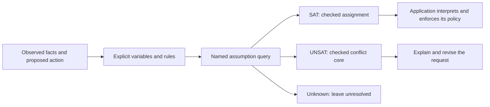

# What can I do with logic-zig?

Turn an explicit rule or model into a question with an inspectable answer:
a valid assignment, a conflicting set of assumptions, a counterexample trace,
or a checked certificate. These examples run on the real engines in the repo.

With Zig 0.16.0 and Python 3:

```sh
zig build -Doptimize=ReleaseSafe
python3 tools/workflow_demo.py --out ../logic-workflow-evidence
```

The runner saves every input and answer, both state-machine models, the safety
certificate, logs, a receipt and checksums. It checks all twelve determinate
Boolean answers with a separate exhaustive Python oracle, preserves one
budget-exhausted `unknown`, replays the counterexample transitions, and runs a
separate process to check the persisted certificate against both models.
It also explores every reachable state of the saved two-state-bit models with
a separate Python AIG evaluator: the guarded model has three reachable states
and excludes the bad state; the changed model has four and reaches it.

## Choose a task

| Task | Run | Observable result |
|------|-----|-------------------|
| Check a deployment request | `logic-agent run examples/workflows/deployment.json` | Missing approval or rollback readiness gives a conflict core; a fully supplied request gives a checked assignment |
| Diagnose configuration conflicts | `logic-agent run examples/workflows/configuration.json` | Explain debug-in-production, unauthenticated public access, and payments without audit logging |
| Allocate work without double-booking | `logic-agent run examples/workflows/scheduling.json` | Find a two-person assignment; explain incompatible staffing requests |
| Preserve uncertainty | `logic-agent run examples/workflows/budget-exhausted.json` | `WORKFLOW_INCOMPLETE`, `unknown`, exit 1; no fabricated assignment |
| Check a release protocol over time | `protocol-demo --out ../release-protocol` | Check the guarded machine, find a violating trace after removing the guard, export and replay an invariant |
| Independently check an UNSAT proof | [Policy proof walkthrough](../examples/policy/README.md) | A separate DRAT-trim executable accepts the proof and rejects it against a weakened policy |

The executable names in the table live under `./zig-out/bin/` after building.
For custom inputs, see the [workflow format and library integration](WORKFLOWS.md).

## Deployment: explain a blocked request

The rules require approval, passing tests and a rollback plan whenever deployment
is requested. The first query supplies deployment, missing approval, passing
tests and rollback readiness. Its answer includes:

```json
{
  "id": "missing_approval",
  "status": "unsat",
  "core": ["deploy", "!approved"],
  "core_verified": true,
  "core_deletion_minimal": true
}
```

The tests and rollback facts are absent from the explanation because removing
them does not resolve this contradiction. Supply approval and the next query
returns a SAT model checked against the original clauses and assumptions.
Each query uses the same base rules and reusable solver session.

An application can use this result to explain a request before deciding whether
to execute it. The application must bind observed facts to assumptions; an
unconstrained `approved` variable is a value the solver may choose, not evidence
that a human approved anything.

## Configuration: identify the settings that disagree

The configuration example encodes four rules: production disables debug,
production requires authentication, public access requires authentication,
and payments require audit logging. The payments query includes `!debug`, but
its conflict is only `payments` and `!audit_log`. That is an assumption core
relative to the fixed rules. It is deletion-minimal, not a claim that it is
the smallest explanation among every possible explanation.

Use this pattern in a configuration editor, a build planner, or an agent's
proposed change review: return the conflict to the caller, revise the facts,
then ask again. Named variables keep the answer attached to the settings.

## Application example: convert an answer into a decision

```sh
python3 examples/deployment_gate.py
python3 examples/deployment_gate.py --approved --tests-passed --rollback-ready
python3 examples/deployment_gate.py --approved --tests-passed --rollback-ready --max-conflicts 0
```

These produce `DENY` (exit 1), `ALLOW` (exit 0), and `UNRESOLVED` (exit 3).
Every fact is pinned true or false, so the solver cannot fill in a missing
approval. The application checks the input hash, completion status, query ID,
model validation and correspondence to the supplied facts before allowing.
A missing binary or inconclusive result remains unresolved. The script returns
a local decision; it executes no deployment. The flags represent facts supplied
by the caller, rather than authenticating a human or a test system.

## Scheduling: produce an assignment

The scheduling example requires exactly one reviewer and one release executor
in a single time slot. Each of the two people can do at most one task.
The solver produces a satisfying assignment, rejects a request to give both
tasks to person A, then accepts assigning the release to person B.

This is Boolean feasibility for an explicitly finite staffing model. Dates,
durations, optimization objectives and calendar integrations are not encoded
in this example. Additional slots or qualifications can be expressed with
more variables and clauses; measure larger workloads before making scale claims.

## Release protocol: distinguish a bounded check from a safety proof

The state machine has two state bits (`approved`, `deployed`) and two request
inputs. Both state bits start false:

```text
next_approved = approved OR approve_request
next_deployed = deploy_request AND approved
bad = deployed AND NOT approved
```

Approval persists, and a deployment request uses approval from the current
state. This model has no revocation or external identity/authentication system.

The example produces three distinct pieces of evidence:

1. BMC finds no bad state through four transitions. This establishes the bound.
2. k-induction checks the base and inductive step to establish safety of this
   encoded machine beyond that bound.
3. The explicitly supplied invariant `deployed -> approved` is exported,
   reparsed, and checked for initiation, exclusion of bad states, and preservation
   by transitions. Its origin is reported as supplied, rather than inferred.

Then it removes the approval guard from `next_deployed`. BMC finds a trace
ending in deployment without approval. The example replays the trace's state
updates directly. The original invariant must be rejected against that changed
transition system, even though it still describes initially safe states.

Replay the saved certificate in another process:

```sh
./zig-out/bin/protocol-demo --out ../release-protocol > ../release-protocol.json
./zig-out/bin/logic-cert verify-invariant ../release-protocol/safe.aag ../release-protocol/safe.invariant.txt
./zig-out/bin/logic-cert verify-invariant ../release-protocol/unsafe.aag ../release-protocol/safe.invariant.txt
```

The safe pair returns `INVARIANT_VERIFIED`, exit 0. The changed model returns
`INVARIANT_REFUSED`, exit 1. These are internal SAT-backed certificate checks;
the separate DRAT example demonstrates independent-tool proof checking.

## Optional: have upstream tools check the exported models

The protocol example exports classic ASCII AIGER with explicit current/next/init
latch records. This follows the [AIGER format](https://fmv.jku.at/aiger/FORMAT.aiger).
For a fresh checker installation, build the pinned tools, then run:

```sh
scripts/build-checkers.sh
scripts/build-aiger.sh
python3 tools/workflow_demo.py --out ../workflow-external-evidence --aigtoaig third_party/aiger/aigtoaig --abc third_party/abc/abc
```

Both setup scripts download upstream source and require Git, Make and C/C++
build tools. They refuse to overwrite existing checker directories. Existing
executables can instead be passed directly to the runner.

The upstream AIGER utility must accept both exports and convert them to binary.
ABC must then prove the guarded model and report a counterexample for the changed
model. Exit 0 alone is insufficient: the runner requires the corresponding
positive result text, records both binary hashes and saves the converted models
and logs. Missing tools or unknown results cannot pass this optional check.
This is measured agreement on the two worked models, not general engine parity.

## How these pieces fit an application



The JSON report records computation, not permission. `WORKFLOW_OK` means the
queries completed with checked models or cores; it includes UNSAT answers.
`TRUST_OK` is a separate health report of the repo's finite fixture suite.
For an actual action, pin the proposed action and all required observed facts,
inspect its particular answer and evidence, and enforce the decision in the
application that owns the action.
